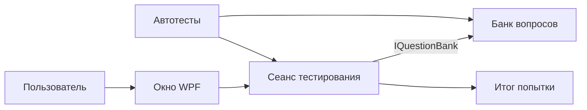

# Архитектура и реестр артефактов

## Начальное состояние и назначение

До начала работы удалённый репозиторий не содержал коммитов или файлов. Проект создаётся с нуля. Система предназначена для прохождения учебного теста с одним вариантом ответа на вопрос и просмотра результата: числа правильных ответов и процента.

На момент составления документа это проектное решение: код и проверки появятся в последующих этапах.

## Границы первой версии

Пользователь запускает локальное WPF-приложение, начинает тест, отвечает по порядку на подготовленные вопросы и получает результат после последнего ответа. Тест можно запустить заново. Банк содержит демонстрационные вопросы по C# и хранится в программе. Имя студента, преподавательский кабинет, сеть, сервер, базы данных, импорт вопросов, учётные записи и сохранение результатов между запусками в первую версию не входят. Реальные персональные данные собирать не нужно.

## Артефакты

| Артефакт | Назначение | Состояние на этапе 1 |
|---|---|---|
| `docs/architecture.md` | Границы, модули, схема, зависимости, решения | Создан |
| `docs/contracts.md` | Контракты и примеры двух взаимодействий | Создан |
| `docs/stages/` | Отчёты и подтверждения проверок по пяти этапам | Начато |
| `docs/version-control.md` | Правила Git и разрешения конфликтов | Планируется на этапе 2 |
| `.gitignore`, `.editorconfig` | Исключение производных файлов и единый стиль | Планируются на этапе 2 |
| `KnowledgeTesting.Core/` | Банк вопросов, модели, сеанс тестирования | Планируется на этапе 3 |
| `KnowledgeTesting.Desktop/` | Окно WPF и пользовательский сценарий | Планируется на этапе 3 |
| `KnowledgeTesting.Tests/` | Модульные и интеграционные тесты | Планируется на этапе 3 |
| `README.md` | Подготовка окружения, сборка и запуск | Будет дополнен |

## Модули и ответственность

- **Банк вопросов** создаёт и выдаёт набор вопросов с вариантами и правильными ответами. Не управляет окном и прохождением.
- **Сеанс тестирования** получает набор через интерфейс банка, проверяет ответы, ведёт счёт и возвращает результат после завершения.
- **Интерфейс WPF** отображает текущий вопрос, принимает выбор и показывает результат; вычисление оценки ему не принадлежит.
- **Тесты** проверяют отдельные правила и взаимодействие банка с сеансом.

## Зависимости

Внутренние: WPF и тесты зависят от Core; сеанс обращается к `IQuestionBank`, не зависит от WPF. Внешние: Git, .NET SDK 9, Windows Desktop Runtime для запуска WPF, тестовые пакеты NuGet с версией, зафиксированной в файле проекта тестов. На Linux можно собрать Windows-проект при `EnableWindowsTargeting`, а тесты ядра запустить без WPF; запуск окна требует Windows.

## Сборка и запуск: план

После реализации: `dotnet restore`, `dotnet build`, `dotnet test`; в Windows `dotnet run --project KnowledgeTesting.Desktop`. На этапе 1 эти команды ещё не подтверждают работоспособность: проекты не созданы.

## Стратегия тестирования

Модульные тесты: валидация вопросов, допустимых вариантов и границ, подсчёт результата, запрет ответа после завершения. Интеграционные: создание сеанса с настоящим банком, прохождение всех вопросов и отказ при неверном варианте. Проверять нулевые данные и пограничные случаи. Отдельно вручную проверить окно на Windows; тесты ядра не подтверждают работу визуального интерфейса.

## Git и технические решения

Каждому этапу соответствует ветка `stage/NN-*`; для этапа 3 отдельные ветки модулей моделируют команду. Изменения фиксируются осмысленными коммитами, объединяются в ветку этапа и `main`; детали на этапе 2.

| Решение | Обоснование | Последствие |
|---|---|---|
| ADR-001: локальное приложение WPF и .NET 9 | C# и .NET 9 соответствуют заданию; окно удобно для выбора ответа | Для запуска нужен Windows; SDK 9 выбран для учебного задания |
| ADR-002: ядро отдельно от окна, банк через интерфейс | Модули и интеграционную границу можно тестировать независимо от WPF | Нужно поддерживать контракт и тесты при изменениях |
| ADR-003: демонстрационный банк и результат в памяти | Минимальная воспроизводимая версия без инфраструктуры | Нет постоянного хранения и защиты ответов от пользователя |
